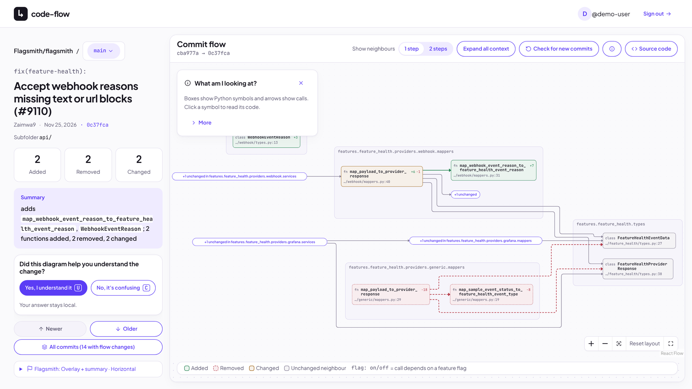
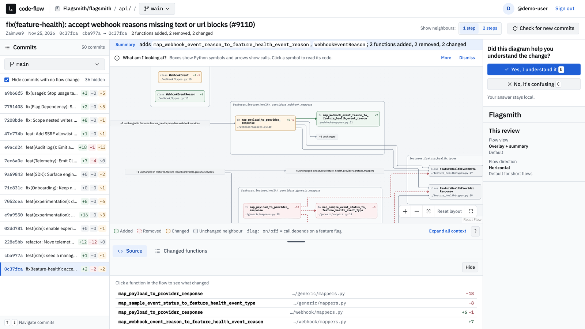
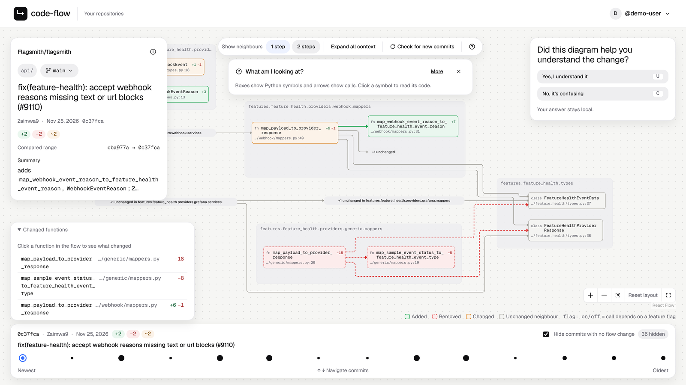
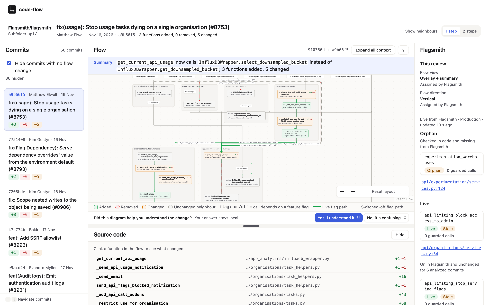

# code-flow

code-flow turns Python commits into diagrams of the functions and calls that
changed. Import a public GitHub repository, pick a commit in the timeline, and
click a function to read its source diff. The demo uses the `api/` folder of
Flagsmith/flagsmith. The viewer also shows where the code checks feature flags
and which calls those checks guard.

**Live demo** [code-flow.pages.dev](https://code-flow.pages.dev) (the API can take up to a minute to wake) · [Deploy guide](docs/DEPLOY.md)

Built for the WeMakeDevs × Flagsmith Toggle Wars hackathon, Track 01
(**Test Something Real**).


## How code-flow uses Flagsmith

- **Experiments decide the product.** Four experiments ran through Flagsmith
  Experimentation, each with a hypothesis, a multivariate flag, exposure from
  `getExperimentFlag`, and metrics from the app's own events: the whole app
  (`app_flow` plus eleven `ui_*` switches), the diff style (`flow_view`), the
  layout for long flows (`flow_direction`), and Sign in with GitHub
  (`github_signin`). Each winner was rolled out from Flagsmith.
- **Flagsmith mode reads your flags.** The analyzer finds Flagsmith and
  OpenFeature checks in the analyzed code, and the viewer asks Flagsmith which
  of those flags are on, so it can highlight live paths and mark checks with
  no matching flag as orphans (`flagsmith_mode`, `live_flag_panel`).
- **Flags run the app.** `variant_preview` lets the team preview any variant,
  `branch_commit_count` sets how many commits a branch import analyzes, and
  each `ui_*` switch can be turned off to fall back to the earlier UI.
- **Without Flagsmith,** code-flow falls back to the earlier UI with fixed
  defaults, no experiment runs, and the diagrams lose their live paths.

## Which whole app helps reviewers finish? · `app_flow`

We built three complete versions of the reviewer journey (landing, sign-in,
repositories, repository, flow view, branch switch): **A Guided**, **B
Workbench** and **C Canvas**. One multivariate flag, `app_flow`, picks the
version (34/33/33). Eleven `ui_*` switches let each piece (each screen's
layout, colours, fonts, buttons) follow the flow, be pinned, or be split as its
own experiment. The main metric is Journey completed: the reviewer understood
the diff, then switched to a second branch and reached its flow view.

Every run used simulated reviewers in the Development environment, and every
number is Flagsmith's own analysis:

1. **Whole apps, 1,000 reviewers.** Workbench lost: 29.3% finished, against
   36.0% for Guided (2% chance to beat it). Guided and Canvas (38.7%) were too
   close to call.
2. **Each piece on its own, 11 rounds of 1,000 fresh reviewers.** Two pieces
   crossed 95%, but both contradicted the simulator's own assumptions. With 22
   comparisons, one or two lucky wins are expected, so we pinned both back to
   Guided.
3. **Confirmation, 30,000 reviewers, everything else fixed.** Guided's flow
   view finished 36.0% of journeys, against 33.8% for Canvas and 31.2% for
   Workbench, with both intervals below zero.

Guided is rolled out in Development. The lesson we kept: confirm a narrow win
with a round sized for the gap before rolling it out.
[Full results, all 11 rounds](docs/experiment-results.md#app_flow-experiment-which-whole-app-helps-reviewers-finish-simulated-reviewers) · [How the rounds run](docs/APP_FLOW_BUILD.md)

| A Guided | B Workbench | C Canvas |
| --- | --- | --- |
|  |  |  |

## Diff style · `flow_view`

We hypothesized that reviewers would understand changes more often and faster
with an overlay and a one-line summary than with side-by-side diagrams.
Flagsmith assigned reviewers to `side_by_side` (34%), `overlay` (33%), or
`overlay_summary` (33%). The viewer records exposure when it reads the
experiment flag and sends a timed `diff_understood` or `diff_confusing` event
when the reviewer answers.

In the Production run with 1,300 simulated reviewers, Flagsmith Experimentation
reported 66.5% understanding with `overlay_summary` and 50.9% with
`side_by_side`. That was a 30.6% relative lift (95% credible interval 15.6% to
45.6%). The mean time per exposure was 20.7% lower. We rolled out
`overlay_summary` to 100% in Production. The simulator's assumptions encode
the hypothesis. A study with real reviewers would test it. [Full results and metric definitions](docs/experiment-results.md)

| Side by side | Overlay + summary |
| --- | --- |
|  |  |

## Long flows · `flow_direction`

We tested horizontal and vertical layouts for changes with at least four call
layers. At 1,300 simulated reviewers, Flagsmith reported 67.0% understanding
for vertical and 60.8% for horizontal. The time result was inconclusive.
Production uses vertical for long flows and horizontal for short flows.
[Full results](docs/experiment-results.md#flow_direction-experiment-results-simulated-reviewers-long-flows)

## Sign in with GitHub · `github_signin`

We tested whether more visitors finish an import when they can sign in with
GitHub and pick any repository they allow, including private ones, instead of
pasting a public URL. With 1,300 simulated visitors in the Development
environment, Flagsmith reported 62.3% completed imports with sign-in and 52.1%
without, a 19.4% lift (95% credible interval 8.1% to 30.8%). The cost is time:
visitors who reached a flow waited about twice as long, because of the trip to
GitHub. Abandonment was inconclusive. Sign-in is rolled out in Development.
[Full results](docs/experiment-results.md#github_signin-experiment-results-simulated-visitors)

## Run locally

Install Git, [uv](https://docs.astral.sh/uv/), Python 3.11+, and Node.js 22.12+.
Run these commands from the repo root.

```sh
cp .env.example .env
make install
make analyze-flagsmith
make dev
```

Open <http://localhost:5173/> and choose **Open the Flagsmith demo**.
The analysis script selects 50 recent first-parent commits that touch `api/`.
To import another repo, choose **Analyze your own repo**.
For GitHub imports, **Check for new commits** fetches the default
branch and keeps existing history up to the configured cap. The viewer keeps
your selected commit while it remains in that history. [Refresh screenshot](docs/screenshots/check-for-new-commits.png)

### Sign in with GitHub

To analyze private repositories, create a read-only GitHub App and set its
`GITHUB_*` values and `VITE_API_URL=/` in `.env`. Signed-in visitors pick a
repository and a branch, then analyze its latest commits (20 by default, set
by the `branch_commit_count` flag). code-flow can only clone the repositories
each person allows, and only that person sees a private import. Sign-in is the `github_signin` arm of a Flagsmith experiment against
the URL form. [Setup, security model and experiment](docs/GITHUB_SIGNIN.md)

### Connect Flagsmith

Start a self-hosted Flagsmith instance with Docker Compose and set
`EXPERIMENTATION_ENABLED=true` on its API and task processor. Create a
`code-flow` project with Production and Development environments, then put
your admin API key in the local `.env` as `FLAGSMITH_ADMIN_API_KEY`.
[Official Flagsmith Compose file](https://github.com/Flagsmith/flagsmith/blob/main/docker-compose.yml) · [Environment template](.env.example)

```sh
make flagsmith-setup-dry-run
make flagsmith-setup
```

Setup provisions the app flags under `code-flow` and writes the Production SDK
keys and a scope file based on existing project tags. Restart `make dev` to
load the keys. If setup requests warehouse configuration, enable **Flagsmith
database** under **Environment Settings → Warehouse**. Development enables
the view and direction previews. Preview reviews stay local.

The app-flow test has its own flags: `app_flow` and eleven `ui_*` switches, tagged
`app-flow`. Create them in Development with `make flagsmith-setup-app-flow-dry-run`,
then `make flagsmith-setup-app-flow`. That command writes only these flags, and it
writes Production only with `--environment Production --only app-flow`. A flag that
already exists keeps its values and only gets the tag, so create them in Development first.

The demo project has no repo flags, so the Flagsmith and OpenFeature checks in
Flagsmith/flagsmith appear as **orphan** when connected with both
`flagsmith_mode` and `live_flag_panel` on. To see live, off, or stale findings
and live-path highlighting, create a flag with the exact name of a detected
check in your Flagsmith project and tag it `repo:flagsmith-api`. Rerun
`make flagsmith-setup` to refresh the scope file.

[Earlier demo with repo flags configured](docs/screenshots/m3-flagsmith-orphan-and-stale.png)

### Replay the experiments in Development

```sh
make simulate-dry-run
make flagsmith-setup-sim
python3 scripts/flagsmith_experiment.py --experiment flow_view create
make simulate
python3 scripts/flagsmith_experiment.py refresh --wait 120
python3 scripts/flagsmith_experiment.py status
```

For the layout experiment, pass `--experiment flow_direction` to the
experiment script and run
`uv run --project simulator python simulator/simulate.py --experiment flow_direction`.
For the sign-in experiment, pass `--experiment github_signin` and run
`make simulate-signin`, which simulates the whole import journey.
The simulator uses the fixed 1,300-reviewer panel. The simulator and experiment
CLI default to Development. Production writes require explicit
`--environment Production`. [Reviewer panel](simulator/panels/default.csv) · [Simulator configurations](simulator/experiments/)

Run `make test` and `make lint` to verify the project.
[Architecture and JSON schemas](docs/ARCHITECTURE.md) · [MIT license](LICENSE)
