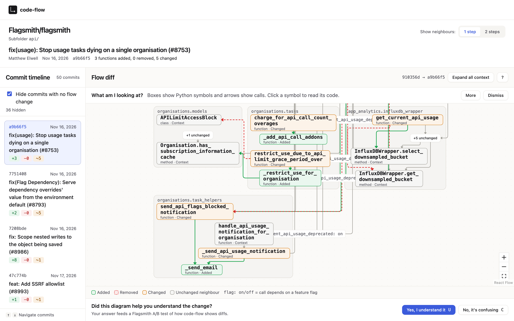
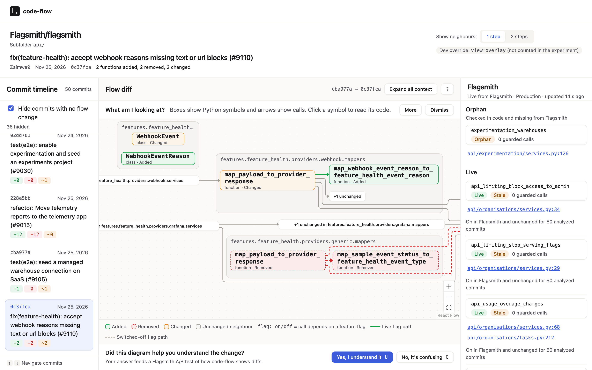
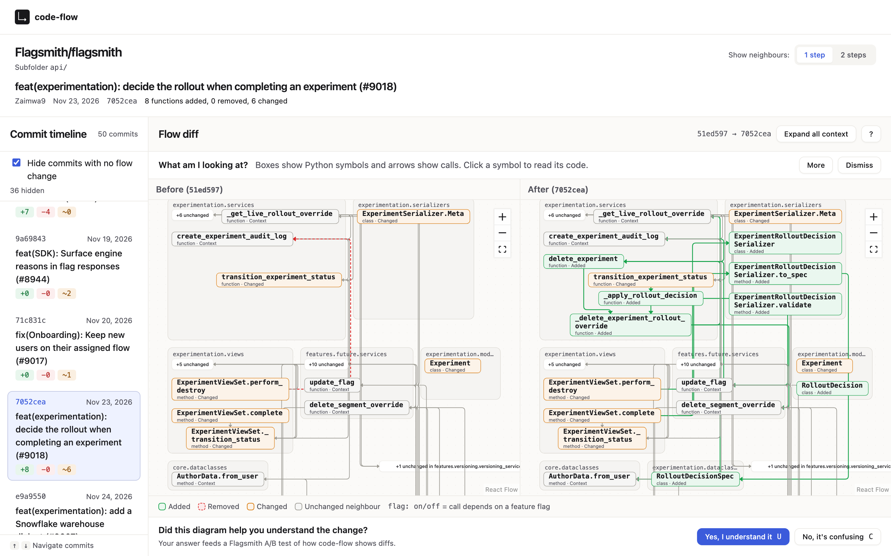
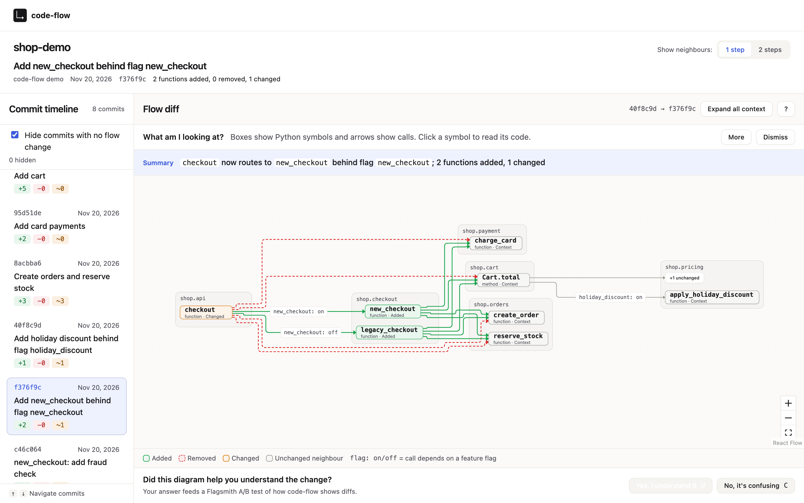
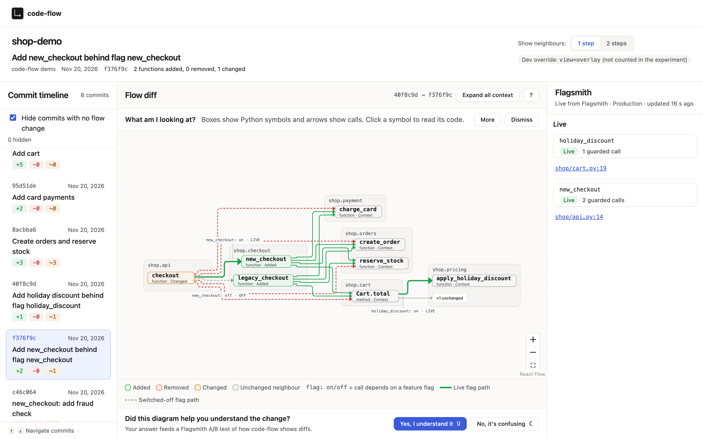
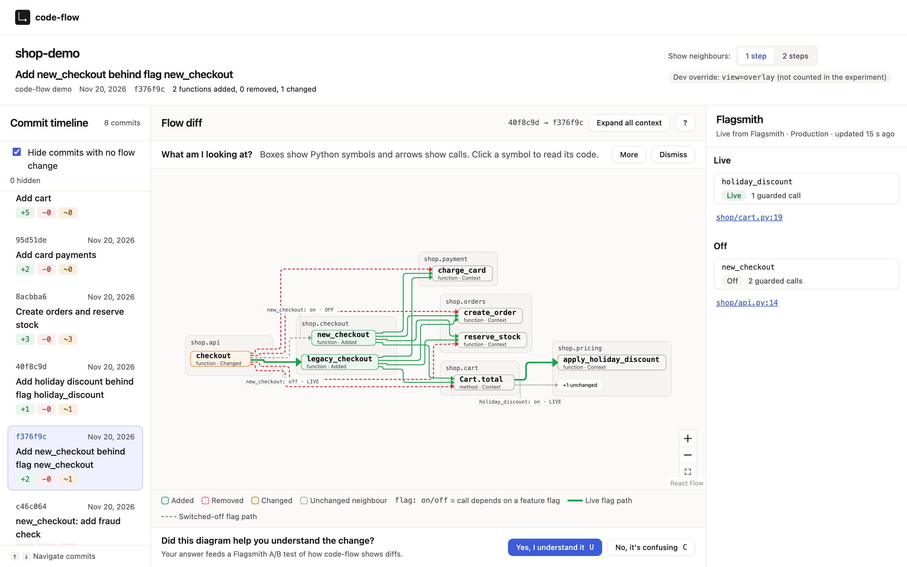
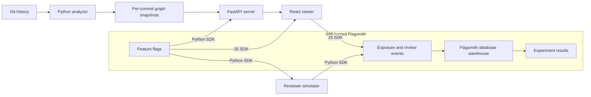

# code-flow

**See how your code's flow changes, commit by commit, as a diagram instead of a 1,000-line diff.**

AI-generated code still needs review. A diagram of the calls that changed
helps reviewers see what moved and decide where to read the source.

Built for the WeMakeDevs × Flagsmith **Toggle Wars** hackathon, Track 01
(**Test Something Real**).

## Screenshots


*Import a Python repository or open one that's already analyzed.*



*Flagsmith commit `a9b66f5` shows changes to the API usage tasks and their guarded calls.*



*The Flagsmith panel shows an orphan flag, stale flags, and links to the checks in source.*

### Three experiment views

| Side by side | Overlay | Overlay + summary |
| --- | --- | --- |
|  |  |  |
| Compare two synchronized canvases. | See changes on one canvas. | Read a one-line summary above the overlay. |

### One flag, two live paths

| `new_checkout` on | `new_checkout` off |
| --- | --- |
|  |  |
| The live path goes to `new_checkout`. | The live path goes to `legacy_checkout`. |

## What it does

- Import a public GitHub repository, optionally limited to one subfolder.
- Walk recent commits and build a graph of Python functions and calls for each one.
- Show added, removed, and changed functions and calls in a commit timeline.
- Compare two synchronized diagrams, a single overlay, or an overlay with a summary.
- Click a function to read its source at the selected revision.
- Find feature flag checks and highlight the guarded calls that are live.

## How we use Flagsmith

### Branches and environments

The keys supplied at deployment select the Flagsmith environment. The web build uses
`VITE_CODEFLOW_FLAGSMITH_ENV_KEY` and the API server uses
`CODEFLOW_FLAGSMITH_SERVER_KEY`.

- **`develop` / dev deploy.** Use Development keys. Set the web key to the
  value of `CODEFLOW_SIM_FLAGSMITH_ENV_KEY` written by `make flagsmith-setup-sim`.
  Create or copy a server-side key from the Development environment for the API.
  `variant_preview` is on, so the viewer can preview any view or direction.
- **`main` / prod deploy.** Use Production keys. `variant_preview` is off and
  the viewer serves the rolled-out view and long-flow direction from Flagsmith.
  Short flows are horizontal.

For local web builds, Vite also reads `.env.development.local` and
`.env.production.local` from the **repo root**. Put the matching
`VITE_CODEFLOW_FLAGSMITH_ENV_KEY` in each file. `npm run dev` uses development
mode and `npm run build` uses production mode by default. To build with
development mode settings, run `npm run build -- --mode development` from
`web/`. These files are gitignored. Keep keys out of Git.

The simulator uses `CODEFLOW_SIM_FLAGSMITH_ENV_KEY`. The simulator and
experiment script default to `CODEFLOW_SIM_ENVIRONMENT` (`Development`).
[Simulation setup](#5-send-simulated-traffic-and-read-results)

The recorded `flow_view` and `flow_direction` runs used simulated reviewers in
Production before this split. Their results are recorded in the [experiment
results](docs/experiment-results.md). Production serves `overlay_summary` for
`flow_view` and `vertical` for long flows.

### The A/B test

**Hypothesis.** Reviewers understand a change more often and faster with an
overlay and a one-line summary than with before and after diagrams side by side.

The multivariate flag `flow_view` assigns one view per reviewer.

| Variant | Allocation | View |
| --- | ---: | --- |
| `side_by_side` (control) | 34% | Before and after |
| `overlay` | 33% | One diagram |
| `overlay_summary` | 33% | One diagram and a one-line summary |

- **Exposure.** The web app identifies the reviewer, then calls
  `getExperimentFlag('flow_view')` in the Flagsmith JS SDK. The simulator
  calls `get_experiment_flag` in the Python SDK with each reviewer's identity.
- **Preview variant.** In Development, the viewer header sets a `?view=`
  override. While either preview override is active, the viewer skips
  experiment exposures and keeps review answers local. **Back to my assigned
  variant** restores the Flagsmith view.
- **Outcome.** **Yes, I understand it** sends
  `trackEvent('diff_understood', {value: ms})`. **No, it’s confusing** sends
  `diff_confusing`. The value is the time from diagram render to answer, in
  milliseconds. The simulator sends the same events through the Python SDK.
- **Metrics.** **Diff understood** is the primary metric, the share of exposed
  reviewers who send `diff_understood`. **Diff time to understand (ms)** is the
  mean value of that event per exposure. Reviewers who never send it count as
  zero for the time metric, so treat it as indicative.
- **Analysis.** We ran Flagsmith Experimentation on a self-hosted Docker
  instance with the **Flagsmith database** warehouse. Flagsmith computed
  lift, 95% credible intervals, and win probabilities.
  [Flagsmith Experimentation docs](https://docs.flagsmith.com/experimentation)

### Results from 1,300 simulated reviewers

| Metric | Variant | Rate or mean | Lift vs control | 95% credible interval | Win probability |
| --- | --- | ---: | ---: | ---: | ---: |
| Diff understood | `side_by_side` | 50.9% | — | — | — |
| Diff understood | `overlay` | 61.1% | +19.9% | +5.7% to +34.2% | 99.7% |
| Diff understood | `overlay_summary` | 66.5% | +30.6% | +15.6% to +45.6% | 100.0% |
| Diff time to understand | `side_by_side` | 52,466 ms | — | — | — |
| Diff time to understand | `overlay` | 48,418 ms | −7.7% | −26.6% to +11.2% | 78.8% |
| Diff time to understand | `overlay_summary` | 41,596 ms | −20.7% | −36.3% to −5.1% | 99.5% |

| Reviewers | Control / overlay / overlay + summary | `overlay_summary` lift on Diff understood | Win probability |
| ---: | --- | ---: | ---: |
| 100 | 24 / 41 / 35 | Withheld | — |
| 300 | 94 / 111 / 95 | +37.7% (+3.1% to +72.2%) | 98.4% |
| 1,300 | 432 / 447 / 421 | +30.6% (+15.6% to +45.6%) | 100.0% |

Flagsmith withheld lift and win probability at 100 reviewers. Its minimums
were 50 reviewers and five conversions per variant.
[Experiment results and interpretation](docs/experiment-results.md)

### Reuse the reviewer panel

The `default` panel contains the same 1,300 simulated reviewers already registered
in Flagsmith, with fixed identities and traits for role, experience, codebase
familiarity, and reading style. Run `make panel-profiles` to see the breakdown,
or open **code-flow → Production → Identities** in Flagsmith and select an
identity to see its traits. [Sample reviewer profiles](docs/simulated-reviewers-sample.csv) ·
[Full panel](simulator/panels/default.csv)

The personas and their effects are assumptions, and simulated results cannot
tell you which feature real users prefer. Use the simulator to rehearse the
setup, check event wiring, and estimate how many reviewers a real test needs.
[Shared persona assumptions](simulator/personas.yaml) · [Flow view assumptions](simulator/experiments/flow_view.yaml)

Run `make simulate-dry-run` to rehearse `flow_view` offline. For another feature,
copy `_template.yaml` to a new file in `simulator/experiments/`, such as
`example_feature.yaml`. Set the feature flag,
its exact variant values and control, the success and failure event names, and
the assumptions for each variant and the variant-neutral `null` model. Set up
the matching experiment and metrics in Development before running live.
[Experiment template](simulator/experiments/_template.yaml)

```sh
cd simulator
uv run python simulate.py --experiment example_feature --panel default --dry-run
uv run python simulate.py --experiment example_feature --panel default
```

Use `--limit N` and `--offset K` to run a slice of the panel in CSV order.
Use `--model null` to rehearse with the same behaviour assumptions for every
variant. `--seed` controls decision sampling, and `--rate` sets the live pace.
Use `--panel generated --n N --prefix <fresh-prefix>` to create new identities.

The `default` panel can run in Development after its recorded Production runs.
A live repeat for the same reviewers, flag, and environment requires
`--allow-repeat`. The simulator records selections in `data/simulator-runs.sqlite3`
before sending events, so an interrupted run can trigger the warning on retry.
Check Flagsmith first if another checkout has sent traffic.

### Flow direction experiment

`flow_direction` compares horizontal (ELK RIGHT) and vertical (ELK DOWN)
layouts in a 50/50 split. The hypothesis is that reviewers understand top-down
layouts more often and faster on long flows. The default cutoff of four call
layers at one hop selects five of the 14 flow-changing Flagsmith API commits.
Once the flag is set up, the viewer records exposure only for eligible long
flows. Yes and No send elapsed milliseconds with `layout_understood` and
`layout_confusing`, respectively. In Development, Preview direction works on
any flow and keeps the review out of both experiments.

After setting up Development in step 5, preview experiment creation and
rehearse both assumption models with the default panel.

```sh
python3 scripts/flagsmith_experiment.py --experiment flow_direction create --dry-run
uv run --project simulator python simulator/simulate.py --experiment flow_direction --dry-run
uv run --project simulator python simulator/simulate.py --experiment flow_direction --dry-run --model null
```

[Depth distribution and eligibility](docs/ARCHITECTURE.md#long-flow-layout-experiment) ·
[Simulator assumptions](simulator/experiments/flow_direction.yaml)

### Flagsmith mode

The Flagsmith section always shows the active flow settings. The `flagsmith_mode`
flag toggles findings and live path styling. The app polls every 10 seconds,
so the change takes effect while the viewer is open.

The analyzer finds Flagsmith and OpenFeature calls such as
`get_openfeature_client().get_boolean_value(...)`. It resolves supported string
constants and marks calls guarded by each branch. The server uses the
Flagsmith Python SDK and a server-side key to read the live environment state.
Flipping a flag moves the green live path in the diagram.

The panel shows live and off flags, orphan checks, unused flags, and stale
findings. The demo analysis of Flagsmith's own `api/` found 13 checks across 10
flags. That includes stale flags and the orphan `experimentation_warehouses`.
The code checks that key, and Flagsmith's own `environment.json` had no entry for it.

We use one project, `code-flow`, in a free Flagsmith organisation.
The idempotent `make flagsmith-setup` command creates missing flags and tags.

| Tag | Flags |
| --- | --- |
| `code-flow` | `flow_view`, `flow_direction`, `flagsmith_mode`, `ai_summary`, and `variant_preview` |
| `repo:flagsmith-api` | Seed flags from Flagsmith's `api/integrations/flagsmith/data/environment.json` |
| `repo:shop-demo` | `new_checkout` and `holiday_discount` |

## Quick start

You need Git, [uv](https://docs.astral.sh/uv/), Python 3.11 or later, Node.js
22.12 or later, and Docker with Compose. Run the shell commands from the
code-flow repo root once you've cloned it.

```sh
git clone https://github.com/P-aveen06/code-flow.git
cd code-flow
cp .env.example .env
make install
```

### 1. Start self-hosted Flagsmith

Download the official Compose file. Set `EXPERIMENTATION_ENABLED: 'true'` on
the Flagsmith API and task processor. The downloaded file includes this in
the shared environment block.
[Official Flagsmith Docker Compose file](https://github.com/Flagsmith/flagsmith/blob/main/docker-compose.yml)

```sh
mkdir -p data/flagsmith-docker
curl -fsSL https://raw.githubusercontent.com/Flagsmith/flagsmith/main/docker-compose.yml \
  -o data/flagsmith-docker/docker-compose.yml
docker compose -f data/flagsmith-docker/docker-compose.yml up -d
```

Open <http://localhost:8000>. Create an account and an organisation, then
create a project named `code-flow` with `Production` and `Development`
environments. Open
**Organisation settings → API Keys** and create an admin API key. A personal
API token with admin access also works. Set `FLAGSMITH_ADMIN_API_KEY` in
the local `.env`. Keep that file out of Git. The default Flagsmith API URL is
already set. [Environment template](.env.example)

### 2. Analyze Flagsmith's API

```sh
make analyze-flagsmith
```

This clones or fetches Flagsmith/flagsmith, analyzes the latest 50 first-parent
commits that touch `api/`, and prints the elapsed time. The app lists the
output as **Flagsmith/flagsmith**. [Analysis script](examples/analyze_flagsmith.sh)

To import in the browser instead, run `make dev` and open
<http://localhost:5173/>. Click **Flagsmith/flagsmith (api/)** under **Try an
example**. Wait for **Import progress** to reach **Ready** and open the viewer.
Stop the dev servers with Ctrl-C before continuing to setup so the next start
reads the new keys.

### 3. Seed Production for the web app

```sh
make flagsmith-setup-dry-run
make flagsmith-setup
```

The dry run previews changes. Setup writes the Production client-side and server-side
environment keys to `.env` and the tag scopes to `data/flagsmith_scopes.json`.
If setup asks you to enable the warehouse manually, use **Production →
Environment Settings → Warehouse → Flagsmith database → Enable**.

### 4. Open the viewer

```sh
make dev
```

Open <http://localhost:5173/> and click **Open** on **Flagsmith/flagsmith**.
Select a commit in the timeline. This link opens the usage-task change
directly. [Flagsmith commit a9b66f5](http://localhost:5173/repo/Flagsmith__flagsmith?commit=a9b66f5)

#### Run the backend and frontend separately

Before you start, make sure self-hosted Flagsmith is running in Docker at
<http://localhost:8000>. Check that the `.env` at the repo root contains the
keys written by `make flagsmith-setup`. The server uses
`CODEFLOW_FLAGSMITH_SERVER_KEY` and the web app uses
`VITE_CODEFLOW_FLAGSMITH_ENV_KEY`.

Open two terminals at the repo root.

**Terminal 1 (API on port 8787)**

```sh
cd server && uv run uvicorn app.main:app --reload --port 8787
```

**Terminal 2 (web app on port 5173)**

```sh
cd web && npm run dev
```

Open <http://localhost:5173>. Stop each process with Ctrl-C. Restart both
after changing `.env`. The server reads `.env` at startup, and Vite reads
`VITE_*` values at startup.

### 5. Send simulated traffic and read results

From the repo root, rehearse the experiment offline with the default panel
and the diffs analyzed in step 2.

```sh
make simulate-dry-run
```

Set up Development, start `flow_view` with both `diff_understood` metrics,
and send the default panel to that experiment.

```sh
python3 scripts/flagsmith_setup.py --environment Development --dry-run
make flagsmith-setup-sim
python3 scripts/flagsmith_experiment.py --experiment flow_view create
make simulate
```

Development setup writes the simulation settings to `.env`, restores the
original flag splits for both experiments, and enables `variant_preview`.
If setup asks you to enable the warehouse manually, use
**Development → Environment Settings → Warehouse →
Flagsmith database → Enable** before starting the experiment.

Ask Flagsmith to refresh results and read the result table.

```sh
python3 scripts/flagsmith_experiment.py refresh --wait 120
python3 scripts/flagsmith_experiment.py status
```

You can also read the results in **code-flow → Development → Experiments →
flow_view: overlay vs side by side** on the Flagsmith dashboard.

The simulator and experiment writes require `--environment Production` to
target Production. To inspect a recorded result, run
`python3 scripts/flagsmith_experiment.py --environment Production status`.

### 6. Try the shop-demo tutorial

Build and analyze the small sample repo, then click **shop-demo (tutorial)**
on the landing page.

```sh
bash examples/make_shop_demo.sh
uv run --project analyzer code-flow analyze examples/shop-demo --branch main --out data/shop-demo
```

Open the commit that introduces `new_checkout`. In the Flagsmith dashboard,
toggle `new_checkout` under **code-flow → Production → Features** and watch
the green path move. [Shop demo commit f376f9c](http://localhost:5173/repo/shop-demo?commit=f376f9c&view=overlay)

```sh
make test
make lint
```

## Architecture



- The analyzer walks first-parent history and parses Python with tree-sitter.
- Each commit gets a JSON graph snapshot. The analyzer can also export a diff as Mermaid.
- FastAPI serves snapshots, diffs, source snippets, and live flag findings.
- The React viewer lays out the changed functions and nearby calls with ELK.
- The browser sends reviewer exposures and outcomes to Production. The simulator targets Development by default.
- Flagsmith computes results from events in its Postgres-backed warehouse.

[Architecture and JSON schemas](docs/ARCHITECTURE.md)

## Limitations

- Reviewers were simulated. The experiment needs real reviewers to test the hypothesis.
- Call resolution is static and heuristic. It can miss dynamic dispatch,
  decorators, and framework-generated calls. Graph edges come only from parsing.
- The analyzer supports Python only.
- Large commits can need zooming and panning.
- Flagsmith mode needs the analyzed repo's flags grouped under its repo tag.
- Self-hosted Flagsmith Experimentation is in beta.
  [Flagsmith self-hosting notes](https://docs.flagsmith.com/experimentation/self-hosting)

## How it was built

Claude (Claude Code) planned the milestones, wrote the task prompts, and reviewed every change. OpenAI Codex CLI implemented it: GPT 6.1 sol for the first milestones, then GPT 6.2 sol. Each change was tested before it was committed, and UI changes were checked in a real browser.

## License

MIT — see [LICENSE](LICENSE).
