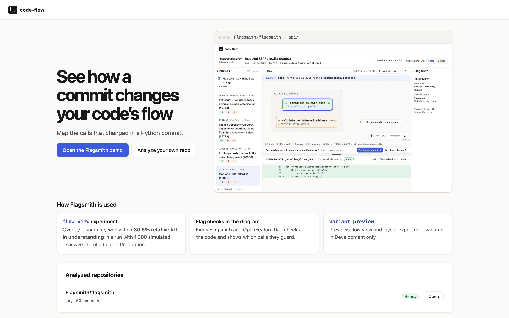

# code-flow

code-flow turns Python commits into diagrams of the functions and calls that
changed. Import a public GitHub repository, pick a commit in the timeline, and
click a function to read its source diff. The demo uses the `api/` folder of
Flagsmith/flagsmith. The viewer also shows where the code checks feature flags
and which calls those checks guard.

**Live demo** [code-flow.pages.dev](https://code-flow.pages.dev) (the API can take up to a minute to wake) · [Deploy guide](docs/DEPLOY.md)

Built for the WeMakeDevs × Flagsmith Toggle Wars hackathon, Track 01
(**Test Something Real**).



## Main experiment · `flow_view`

We hypothesized that reviewers would understand changes more often and faster
with an overlay and a one-line summary than with side-by-side diagrams.
Flagsmith assigned reviewers to `side_by_side` (34%), `overlay` (33%), or
`overlay_summary` (33%). The viewer records exposure when it reads the
experiment flag and sends a timed `diff_understood` or `diff_confusing` event
when the reviewer answers.

In the Production run with 1,300 simulated reviewers, Flagsmith Experimentation
reported 66.5% understanding with `overlay_summary` and 50.9% with
`side_by_side`. That was a 30.6% relative lift (95% credible interval 15.6% to
45.6%). The mean time per exposure was 20.7% lower. We rolled out
`overlay_summary` to 100% in Production. The simulator's assumptions encode
the hypothesis. A study with real reviewers would test it. [Full results and metric definitions](docs/experiment-results.md)

| Side by side | Overlay + summary |
| --- | --- |
|  |  |

## Long flows · `flow_direction`

We tested horizontal and vertical layouts for changes with at least four call
layers. At 1,300 simulated reviewers, Flagsmith reported 67.0% understanding
for vertical and 60.8% for horizontal. The time result was inconclusive.
Production uses vertical for long flows and horizontal for short flows.
[Full results](docs/experiment-results.md#flow_direction-experiment-results-simulated-reviewers-long-flows)

## Run locally

Install Git, [uv](https://docs.astral.sh/uv/), Python 3.11+, and Node.js 22.12+.
Run these commands from the repo root.

```sh
cp .env.example .env
make install
make analyze-flagsmith
make dev
```

Open <http://localhost:5173/> and choose **Open the Flagsmith demo**.
The analysis script selects 50 recent first-parent commits that touch `api/`.
To import another repo, choose **Analyze your own repo**.
For GitHub imports, **Check for new commits** fetches the default
branch and keeps existing history up to the configured cap. The viewer keeps
your selected commit while it remains in that history. [Refresh screenshot](docs/screenshots/check-for-new-commits.png)

### Sign in with GitHub

To analyze private repositories, create a read-only GitHub App and set its
`GITHUB_*` values and `VITE_API_URL=/` in `.env`. Signed-in visitors pick a
repository and a branch, then analyze its latest commits (20 by default, set
by the `branch_commit_count` flag). code-flow can only clone the repositories
each person allows, and only that person sees a private import. Sign-in is the `github_signin` arm of a Flagsmith experiment against
the URL form. [Setup, security model and experiment](docs/GITHUB_SIGNIN.md)

### Connect Flagsmith

Start a self-hosted Flagsmith instance with Docker Compose and set
`EXPERIMENTATION_ENABLED=true` on its API and task processor. Create a
`code-flow` project with Production and Development environments, then put
your admin API key in the local `.env` as `FLAGSMITH_ADMIN_API_KEY`.
[Official Flagsmith Compose file](https://github.com/Flagsmith/flagsmith/blob/main/docker-compose.yml) · [Environment template](.env.example)

```sh
make flagsmith-setup-dry-run
make flagsmith-setup
```

Setup provisions the app flags under `code-flow` and writes the Production SDK
keys and a scope file based on existing project tags. Restart `make dev` to
load the keys. If setup requests warehouse configuration, enable **Flagsmith
database** under **Environment Settings → Warehouse**. Development enables
the view and direction previews. Preview reviews stay local.

The app-flow test has its own flags: `app_flow` and eleven `ui_*` switches, tagged
`app-flow`. Create them in Development with `make flagsmith-setup-app-flow-dry-run`,
then `make flagsmith-setup-app-flow`. That command writes only these flags, and it
writes Production only with `--environment Production --only app-flow`. A flag that
already exists keeps its values and only gets the tag, so create them in Development first.

The demo project has no repo flags, so the Flagsmith and OpenFeature checks in
Flagsmith/flagsmith appear as **orphan** when connected with `flagsmith_mode`
on. To see live, off, or stale findings and live-path highlighting, create a
flag with the exact name of a detected check in your Flagsmith project and tag
it `repo:flagsmith-api`. Rerun `make flagsmith-setup` to refresh the scope file.

[Earlier demo with repo flags configured](docs/screenshots/m3-flagsmith-orphan-and-stale.png)

### Replay the experiments in Development

```sh
make simulate-dry-run
make flagsmith-setup-sim
python3 scripts/flagsmith_experiment.py --experiment flow_view create
make simulate
python3 scripts/flagsmith_experiment.py refresh --wait 120
python3 scripts/flagsmith_experiment.py status
```

For the layout experiment, pass `--experiment flow_direction` to the
experiment script and run
`uv run --project simulator python simulator/simulate.py --experiment flow_direction`.
For the sign-in experiment, pass `--experiment github_signin` and run
`make simulate-signin`, which simulates the whole import journey.
The simulator uses the fixed 1,300-reviewer panel. The simulator and experiment
CLI default to Development. Production writes require explicit
`--environment Production`. [Reviewer panel](simulator/panels/default.csv) · [Simulator configurations](simulator/experiments/)

Run `make test` and `make lint` to verify the project.
[Architecture and JSON schemas](docs/ARCHITECTURE.md) · [MIT license](LICENSE)
